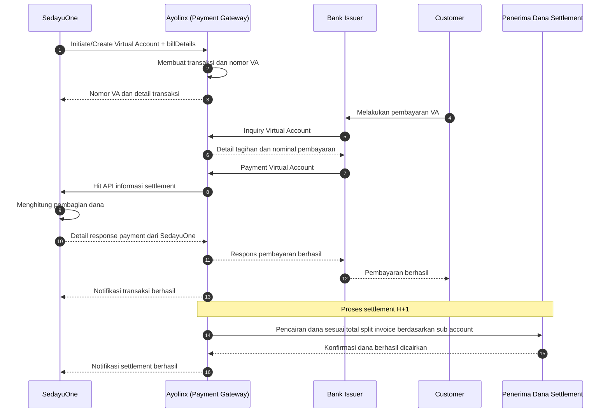

# Sequence Diagram Pembayaran Virtual Account dan Settlement

## Aktor

1. **Bank Issuer** — bank yang digunakan Customer untuk membayar Virtual Account.
2. **Ayolinx** — Payment Gateway dan pengelola transaksi Virtual Account.
3. **SedayuOne** — sistem yang menginisiasi Virtual Account dan menghitung pembagian settlement.
4. **Customer** — pelanggan yang melakukan pembayaran Virtual Account.
5. **Penerima Dana Settlement** — pihak yang menerima pencairan dana hasil proses settlement.

## Diagram

## Urutan Proses

1. SedayuOne menginisiasi pembuatan Virtual Account ke Ayolinx dengan menyertakan informasi `billDetails`.
2. Ayolinx membuat transaksi dan nomor Virtual Account berdasarkan permintaan SedayuOne, termasuk data `billDetails`.
3. Customer melakukan pembayaran Virtual Account melalui Bank Issuer.
4. Bank Issuer mengirimkan inquiry ke Ayolinx untuk memvalidasi Virtual Account dan mengambil informasi tagihan.
5. Bank Issuer meneruskan pembayaran ke Ayolinx. Ayolinx kemudian memanggil API SedayuOne untuk memperoleh nilai settlement yang telah dikalkulasi untuk setiap penerima dana settlement.
6. Ayolinx mengirimkan respons pembayaran berhasil kepada Bank Issuer. Customer menerima konfirmasi pembayaran berhasil dan SedayuOne menerima notifikasi transaksi.
7. Pada H+1, masing-masing penerima dana settlement menerima dana sesuai dengan split invoice berdasarkan sub account.

## Catatan

- Pada saat inisiasi Virtual Account, SedayuOne menyertakan detail tagihan melalui `billDetails` sebagai dasar pembentukan objek detail tagihan SedayuOne.
- Hasil kalkulasi settlement sebaiknya disimpan bersama ID transaksi sebagai dasar rekonsiliasi.
- Setiap permintaan dan respons API sebaiknya memiliki reference ID yang unik untuk mendukung proses audit dan pelacakan transaksi.
- Mekanisme retry dan idempotency diperlukan untuk mencegah pencatatan atau pencairan dana ganda.
- Jika proses settlement gagal, Ayolinx perlu mengirimkan status kegagalan kepada SedayuOne untuk ditindaklanjuti.
